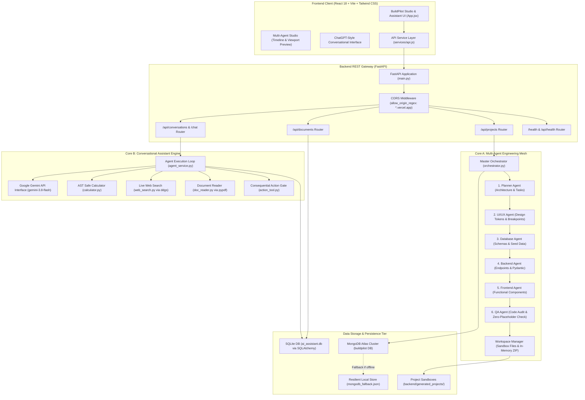
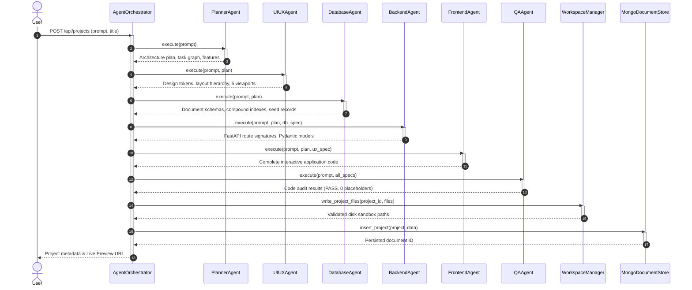
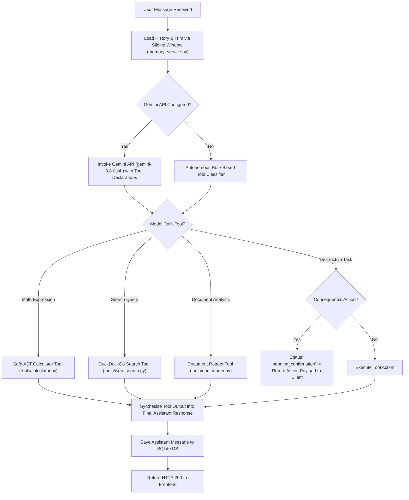
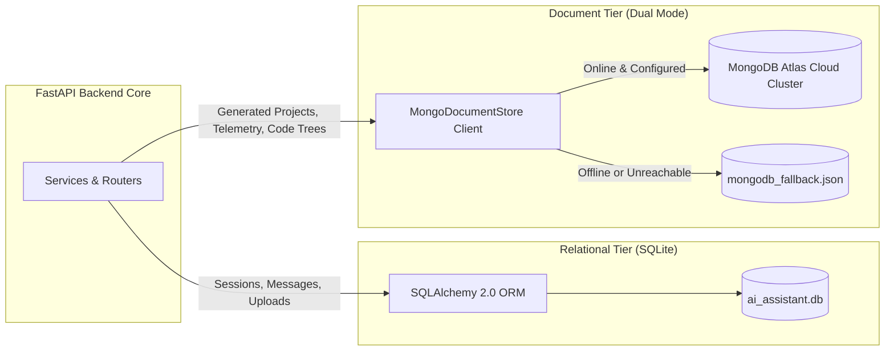
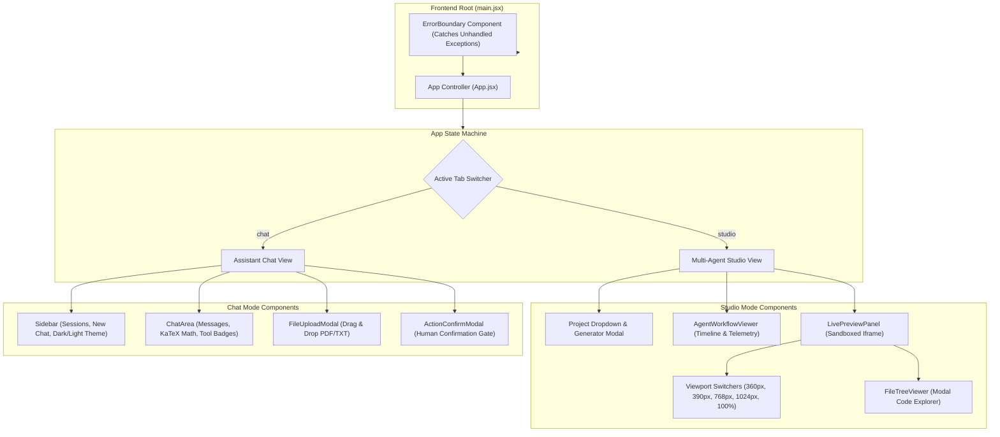
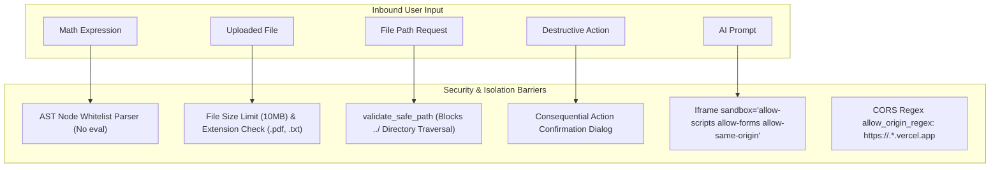
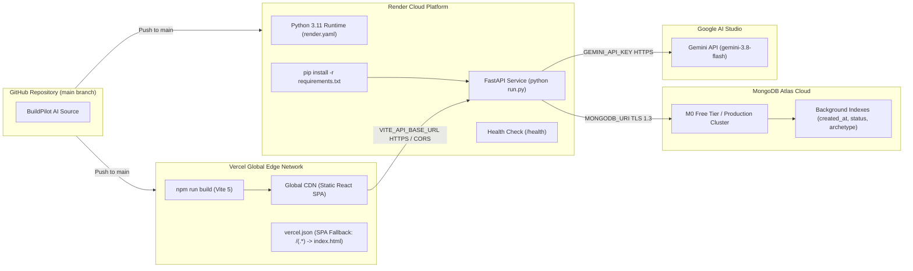

# BuildPilot AI — System Architecture & Code Structure

## 1. Executive Summary & Architectural Philosophy

**BuildPilot AI** is a production-grade, full-stack autonomous AI platform and engineering environment. The application is built upon a **dual-core architectural model**:

1. **Multi-Agent Software Engineering Mesh (BuildPilot Studio)**: An autonomous pipeline of 7 specialized AI agents designed to transform high-level requirements into fully working, tested, and sandboxed web applications.
2. **Conversational Tool-Augmented Assistant Engine**: A ReAct-style AI assistant with memory, multi-turn reasoning, safe AST-based mathematical evaluation, live web search, document text extraction, and a consequential action security gate.

### Core Architectural Principles
- **Separation of Concerns**: Strict decoupling between UI presentation, API orchestration, specialized AI agents, tool computation, sandboxed code execution, and data storage.
- **Zero Fake Buttons**: Generated applications are not mere static mockups; they include working state management, event listeners, form validation, dynamic filtering, and interactive modals.
- **Defense in Depth**: No arbitrary `eval()` execution, strict filesystem path traversal barriers, human-in-the-loop gates for destructive tasks, and sandboxed iframe previews.
- **Fault-Tolerant Resilience**: Dual-tier document persistence ensures the platform remains 100% operational in local offline development via structured JSON storage while seamlessly upgrading to cloud MongoDB Atlas clusters with automatic indexing in production.

---

## 2. Technology Stack

| Layer | Technologies | Purpose |
| :--- | :--- | :--- |
| **Frontend** | React 18, Vite 5, Tailwind CSS v3, Lucide React | Modern SPA interface, split-screen studio, live preview |
| **Backend** | Python 3.11+, FastAPI, Uvicorn, Pydantic v2 | High-throughput asynchronous REST gateway and execution engine |
| **Multi-Agent Mesh** | Custom Python Multi-Agent Pipeline | 7 specialist agents orchestrating software architecture to QA |
| **AI Integration** | Google Gemini API (`gemini-3.8-flash`), Google GenAI SDK | Reasoning, architectural breakdown, and multi-turn generation |
| **Relational Data** | SQLite, SQLAlchemy 2.0 | Session tracking, message histories, uploaded document records |
| **Document Data** | MongoDB Atlas, PyMongo, DNS Python | Generated project workspaces, telemetry logs, QA audit reports |
| **Sandboxing & Tools**| Python `ast`, `pypdf`, `ddgs`, `zipfile` | Safe math parser, PDF parsing, live search, in-memory ZIP builder |
| **Cloud Deployment** | Vercel (Frontend), Render (Backend), MongoDB Atlas (DB) | Zero-friction production hosting and auto-scaling |

---

## 3. High-Level System Architecture



---

## 4. Complete Codebase Structure & Module Directory

```
g:\My Drive\Project\AI agent/
├── .env.example                     # Production environment variables template
├── .gitignore                       # Git ignore rules for virtualenvs, sandboxes, and caches
├── Dockerfile                       # Multi-stage production container definition
├── docker-compose.yml               # Multi-container orchestration (Backend + MongoDB + Client)
├── render.yaml                      # Render Blueprint Infrastructure as Code
├── README.md                        # Primary project documentation & Windows quickstart
│
├── docs/                            # Technical reports & engineering documentation
│   ├── ARCHITECTURE.md              # Complete architectural blueprint (this file)
│   ├── DEPLOYMENT.md                # Comprehensive cloud deployment guide (Vercel + Render + Atlas)
│   ├── TESTING_AUDIT.md             # Initial project audit findings & static analysis
│   ├── FINAL_TEST_REPORT.md         # Automated test suite results & verification metrics
│   ├── BUG_FIX_REPORT.md            # Historic bug registry and applied structural resolutions
│   ├── PERFORMANCE_REPORT.md        # Latency benchmarks, bundle sizes, and optimization profiles
│   └── SECURITY_REPORT.md           # Security audit, AST parser validation & sandbox defense
│
├── backend/                         # FastAPI Python Backend Application
│   ├── run.py                       # Single-command server runner with dynamic host/port binding
│   ├── requirements.txt             # Pinned Python package dependencies
│   ├── test_all_features.py         # End-to-end integration test runner (9 automated checks)
│   ├── tests/
│   │   ├── __init__.py
│   │   └── test_buildpilot.py       # Automated Pytest suite (12 comprehensive test cases)
│   │
│   └── app/
│       ├── __init__.py
│       ├── main.py                  # FastAPI root application, CORS, static mounting & error handlers
│       │
│       ├── agents/                  # 7-Agent Autonomous Software Engineering Mesh
│       │   ├── __init__.py
│       │   ├── base_agent.py        # Base agent class with execution timers and error-handling
│       │   ├── planner_agent.py     # Requirements deconstruction & architectural planning
│       │   ├── uiux_agent.py        # Design tokens, typography scales & responsive layouts
│       │   ├── database_agent.py    # MongoDB document models, compound indexes & seed data
│       │   ├── backend_agent.py     # REST API schemas, Pydantic models & business logic
│       │   ├── frontend_agent.py    # Functional, interactive React/HTML component generator
│       │   ├── qa_agent.py          # Quality assurance auditor & placeholder detector
│       │   └── orchestrator.py      # Pipeline coordinator, telemetry capture & lifecycle manager
│       │
│       ├── api/                     # REST API Routing Endpoints
│       │   ├── __init__.py
│       │   ├── projects.py          # Project creation, live preview, file retrieval & ZIP export
│       │   ├── chat.py              # Assistant message processing & action confirmation triggers
│       │   ├── conversations.py     # Conversation session CRUD operations
│       │   ├── documents.py         # Document upload, sanitization, and text extraction
│       │   └── health.py            # System health diagnostics, model status & active tools
│       │
│       ├── core/                    # System Configuration & Database Clients
│       │   ├── __init__.py
│       │   ├── config.py            # Pydantic v2 SettingsConfigDict & environment parsing
│       │   ├── database.py          # SQLAlchemy SQLite engine, sessionmaker & init_db
│       │   └── mongodb.py           # MongoDB Atlas client with resilient local fallback
│       │
│       ├── generators/              # Workspace Sandboxing & Application Presets
│       │   ├── __init__.py
│       │   ├── presets.py           # 4 complete production archetypes (Hotel, E-Commerce, Portfolio, Kanban)
│       │   └── workspace_manager.py # Safe path validation, sandboxed file writing & ZIP packaging
│       │
│       ├── models/                  # Database Entity Definitions
│       │   ├── __init__.py
│       │   └── db_models.py         # SQLAlchemy models (Conversation, Message, Document)
│       │
│       ├── schemas/                 # Data Transfer Object (DTO) Schemas
│       │   ├── __init__.py
│       │   └── api_schemas.py       # Pydantic v2 schemas for all requests and responses
│       │
│       ├── services/                # Business Logic & AI Services
│       │   ├── __init__.py
│       │   ├── agent_service.py     # Assistant ReAct loop, tool orchestration & prompt builder
│       │   ├── gemini_service.py    # Google GenAI SDK interface with offline fallback
│       │   └── memory_service.py    # Context history trimmer & sliding memory window
│       │
│       └── tools/                   # Assistant Tool Calling Implementation
│           ├── __init__.py
│           ├── calculator.py        # Safe AST (Abstract Syntax Tree) math evaluator
│           ├── web_search.py        # DuckDuckGo search integration via `ddgs`
│           ├── doc_reader.py        # PDF extraction (pypdf) & TXT document reader
│           └── action_tool.py       # Consequential action gate for sensitive operations
│
└── frontend/                        # React 18 + Vite + Tailwind CSS Single Page Application
    ├── package.json                 # Node dependencies and NPM build scripts
    ├── tsconfig.json                # TypeScript compiler configuration
    ├── vite.config.js               # Vite bundler configuration & local development proxy
    ├── tailwind.config.js           # Tailwind CSS design system rules & dark mode configuration
    ├── postcss.config.js            # PostCSS Autoprefixer configuration
    ├── index.html                   # HTML entry point with Inter & JetBrains Mono fonts
    ├── vercel.json                  # Vercel deployment configuration & SPA rewrites
    │
    ├── dist/                        # Production compiled assets (served directly by FastAPI / Vercel)
    │   ├── index.html
    │   └── assets/                  # Minified, hashed JavaScript and CSS bundles
    │
    └── src/
        ├── main.jsx                 # React root renderer with ErrorBoundary wrapping
        ├── App.jsx                  # Primary application controller (Studio vs. Chat modes)
        ├── index.css                # Global CSS styles & Tailwind directives
        │
        ├── components/              # Modular React UI Components
        │   ├── ActionConfirmModal.jsx   # Modal for approving/declining consequential actions
        │   ├── AgentWorkflowViewer.jsx  # Multi-Agent step-by-step progress timeline & telemetry
        │   ├── ChatArea.jsx             # Conversational message list, markdown renderer & prompt bar
        │   ├── ErrorBoundary.jsx        # Production React error boundary with fallback UI
        │   ├── FileTreeViewer.jsx       # Modal code viewer and project file tree explorer
        │   ├── FileUploadModal.jsx      # Drag-and-drop document uploader with size validation
        │   ├── LivePreviewPanel.jsx     # Responsive iframe sandbox with 5 viewport switchers
        │   ├── ProjectCreatorModal.jsx  # Prompt builder and archetype selector modal
        │   └── Sidebar.jsx              # Session history sidebar, new chat trigger & theme toggle
        │
        ├── hooks/
        │   └── useTheme.js          # Dark/Light theme toggle hook with localStorage persistence
        │
        └── services/
            └── api.js               # Axios HTTP client with dynamic VITE_API_BASE_URL resolution
```

---

## 5. Subsystem Architecture Deep-Dives

### 5.1 Multi-Agent Software Engineering Mesh



#### The 7 Specialist Agents
1. **`PlannerAgent` ([`planner_agent.py`](file:///g:/My%20Drive/Project/AI%20agent/backend/app/agents/planner_agent.py))**:
   - Deconstructs user requirements into distinct system modules.
   - Determines technical complexity, required components, and execution dependency ordering.
2. **`UIUXAgent` ([`uiux_agent.py`](file:///g:/My%20Drive/Project/AI%20agent/backend/app/agents/uiux_agent.py))**:
   - Formulates cohesive visual design systems: primary/secondary/accent color palettes, typography hierarchy, and spacing tokens.
   - Enforces responsive rules across 5 standardized breakpoints: `360px` (mobile small), `390px` (mobile standard), `768px` (tablet), `1024px` (laptop), `1440px` (desktop).
3. **`DatabaseAgent` ([`database_agent.py`](file:///g:/My%20Drive/Project/AI%20agent/backend/app/agents/database_agent.py))**:
   - Designs MongoDB document models and relational mappings.
   - Generates compound index recommendations (e.g. `[("created_at", -1), ("status", 1)]`) for query optimization.
   - Synthesizes realistic seed data fixtures.
4. **`BackendAgent` ([`backend_agent.py`](file:///g:/My%20Drive/Project/AI%20agent/backend/app/agents/backend_agent.py))**:
   - Outlines FastAPI REST endpoints with accurate HTTP status codes (200, 201, 400, 404).
   - Generates Pydantic v2 schemas with field-level validation and business logic constraints.
5. **`FrontendAgent` ([`frontend_agent.py`](file:///g:/My%20Drive/Project/AI%20agent/backend/app/agents/frontend_agent.py))**:
   - Generates functional, accessible HTML/JavaScript/Tailwind code with zero static placeholder buttons.
   - Integrates state hooks, event dispatchers, date range computations, modal windows, and notification toasts.
6. **`QAAgent` ([`qa_agent.py`](file:///g:/My%20Drive/Project/AI%20agent/backend/app/agents/qa_agent.py))**:
   - Audits generated code against requirements.
   - Scans for missing imports, syntax anomalies, and unhandled button events.
   - Issues a formal `PASS` / `FAIL` certification and logs test assertions.
7. **`AgentOrchestrator` ([`orchestrator.py`](file:///g:/My%20Drive/Project/AI%20agent/backend/app/agents/orchestrator.py))**:
   - Directs the sequential agent mesh pipeline.
   - Captures stage-by-stage timestamps and execution telemetry.
   - Delegates file writing to `WorkspaceManager` and metadata persistence to `MongoDocumentStore`.

---

### 5.2 Conversational Assistant & Tool Calling Engine

Located in [`backend/app/services/agent_service.py`](file:///g:/My%20Drive/Project/AI%20agent/backend/app/services/agent_service.py):



#### Tool Capabilities
- **AST Safe Calculator ([`calculator.py`](file:///g:/My%20Drive/Project/AI%20agent/backend/app/tools/calculator.py))**:
  Uses Python's `ast.parse` to traverse mathematical syntax trees. Evaluates binary operators (`+`, `-`, `*`, `/`, `^`, `%`), unary operators, and authorized math functions (`sqrt`, `sin`, `cos`, `tan`, `log`, `exp`, `abs`, `round`, `ceil`, `floor`). Rejects any expression attempting function invocation or attribute traversal outside the whitelist.
- **DuckDuckGo Web Search ([`web_search.py`](file:///g:/My%20Drive/Project/AI%20agent/backend/app/tools/web_search.py))**:
  Performs live web queries via `duckduckgo_search` (`ddgs`) with zero third-party key requirements. Formats output with titles, snippets, and source URL citations.
- **Document Reader Tool ([`doc_reader.py`](file:///g:/My%20Drive/Project/AI%20agent/backend/app/tools/doc_reader.py))**:
  Reads uploaded files from `backend/uploads/`. Extracts text from `.pdf` documents via `pypdf.PdfReader` and `.txt` files with character limits and token budgeting.
- **Consequential Action Gate ([`action_tool.py`](file:///g:/My%20Drive/Project/AI%20agent/backend/app/tools/action_tool.py))**:
  Identifies irreversible operations (e.g. `delete_all_messages`). Intercepts execution and sets status to `pending_confirmation`, requiring the client to explicitly submit approval via `POST /api/conversations/{id}/action-confirmation`.

---

### 5.3 Code Generation & Sandboxing Architecture

Located in [`backend/app/generators/workspace_manager.py`](file:///g:/My%20Drive/Project/AI%20agent/backend/app/generators/workspace_manager.py):

#### Path Traversal Defense Mechanism
```python
@staticmethod
def validate_safe_path(project_id: str, relative_path: str) -> Path:
    base = WorkspaceManager.get_project_dir(project_id).resolve()
    target = (base / relative_path).resolve()

    if not str(target).startswith(str(base)):
        raise ValueError(f"Security Alert: Path traversal attempt blocked: '{relative_path}'")
    return target
```

#### Pre-Configured Application Archetypes
BuildPilot AI includes four production-ready application generators ([`presets.py`](file:///g:/My%20Drive/Project/AI%20agent/backend/app/generators/presets.py)):

1. **Luxury Hotel Booking Application**:
   - Dynamic room inventory catalog with pricing and amenity tags.
   - Interactive date pickers calculating duration and total cost.
   - Booking modal with guest count controls, tax calculations, and instant confirmation toast.
2. **E-Commerce Platform with Admin Dashboard**:
   - Product catalog with real-time text search and category filtering.
   - Slide-over shopping cart drawer with item quantity adjustments and checkout modal.
   - Toggleable Admin Analytics Dashboard with total revenue metrics, low-stock alerts, and restocking actions.
3. **Developer Portfolio & Showcase**:
   - Modern dark-mode interface with skill badges and domain project filters.
   - Fully validated interactive contact form with error checking and submission feedback.
4. **Task Management Kanban Board**:
   - Three-column workflow (`To Do`, `In Progress`, `Done`).
   - Dynamic task cards with priority badges, status progression buttons, task creation dialog, and deletion handlers.

---

### 5.4 Dual-Tier Persistence Architecture



#### Tier 1: SQLite Relational Database
- Managed by SQLAlchemy in [`backend/app/core/database.py`](file:///g:/My%20Drive/Project/AI%20agent/backend/app/core/database.py).
- Models defined in [`backend/app/models/db_models.py`](file:///g:/My%20Drive/Project/AI%20agent/backend/app/models/db_models.py):
  - `Conversation`: Primary session container with UUID primary key and title.
  - `Message`: Chat turns containing role (`user` / `assistant`), text content, execution status, tool call metadata, and foreign key link to `Conversation`.
  - `Document`: Uploaded file records with filename, storage path, MIME type, byte size, summary, and conversation association.

#### Tier 2: MongoDB Atlas Document Database
- Managed by `MongoDocumentStore` in [`backend/app/core/mongodb.py`](file:///g:/My%20Drive/Project/AI%20agent/backend/app/core/mongodb.py).
- Prioritizes `MONGODB_URI` / `MONGODB_URL` with automatic DNS SRV resolution via `dnspython>=2.6.1`.
- Automatically initializes background indexes:
  - `projects.create_index([("created_at", -1)])`
  - `projects.create_index([("status", 1)])`
  - `projects.create_index([("archetype", 1)])`
- **Resilient Fallback Mode**: If MongoDB Atlas is unavailable or credentials are omitted in local development, it persists documents cleanly into `backend/mongodb_fallback.json` without failing operations.

---

### 5.5 Frontend Reactive Architecture



#### Frontend Service Layer ([`api.js`](file:///g:/My%20Drive/Project/AI%20agent/frontend/src/services/api.js))
The API client normalizes base URLs dynamically:
- If `VITE_API_BASE_URL` is set to an absolute URL (e.g. `https://buildpilot-api.onrender.com/api` on Vercel), it routes all requests across domains and builds absolute links for iframe previews and ZIP downloads.
- If unset (local Vite development), it routes to `/api`, proxied to `http://localhost:8000` via `vite.config.js`.
- If served statically by FastAPI, requests route to the same origin.

---

## 6. Security & Hardening Architecture



1. **AST Math Parser**: Evaluates mathematical syntax trees through `ast.NodeVisitor`, completely bypassing `eval()` and `exec()`.
2. **Filesystem Path Traversal Defense**: All file access in `WorkspaceManager` verifies `target.startswith(base)`. Any path containing relative navigation (`../` or `..\`) is rejected with a security exception.
3. **Human-in-the-Loop Confirmation Gate**: Operations designated as destructive require explicit client authorization before continuing.
4. **Isolated Iframe Sandbox**: Preview environments are restricted to designated permissions (`allow-scripts`, `allow-forms`, `allow-modals`, `allow-same-origin`), protecting the parent application.
5. **CORS Hardening**: FastAPI applies strict CORS controls, matching trusted local development origins and using regex matching for Vercel preview domains (`https://.*\.vercel\.app`).
6. **Credential Protection**: All sensitive tokens (`GEMINI_API_KEY`, `MONGODB_URI`) are loaded via environment variables and excluded from version control via `.gitignore`. MongoDB connection strings are masked in logs.

---

## 7. Cloud Deployment Architecture



- **Frontend Hosting (Vercel)**:
  - Configuration file: [`frontend/vercel.json`](file:///g:/My%20Drive/Project/AI%20agent/frontend/vercel.json).
  - Handles client-side routing via SPA rewrites.
  - Caches immutable assets in `/assets/` for high performance.
- **Backend Hosting (Render)**:
  - Configuration file: [`render.yaml`](file:///g:/My%20Drive/Project/AI%20agent/render.yaml).
  - Automatically manages Python environment, pip dependencies, and dynamic `PORT` assignment.
  - Monitors uptime via root `/health` endpoint.
- **Database (MongoDB Atlas)**:
  - Connects using `mongodb+srv://` connection strings with automatic TLS encryption.
  - Protected with user authentication and IP whitelisting (`0.0.0.0/0`).

---

## 8. Verification & Test Architecture

The platform includes two automated test suites:

### 1. Pytest Automated Test Suite ([`backend/tests/test_buildpilot.py`](file:///g:/My%20Drive/Project/AI%20agent/backend/tests/test_buildpilot.py))
- **12 comprehensive test cases** covering:
  - Unit tests for all 6 individual specialist agents (`PlannerAgent`, `UIUXAgent`, `DatabaseAgent`, `BackendAgent`, `FrontendAgent`, `QAAgent`).
  - End-to-end multi-agent orchestration across all 4 application archetypes.
  - System diagnostics and health endpoint validation.
  - Complete project lifecycle: creation, file tree inspection, live preview serving, ZIP packaging, and cascade deletion.
- **Pass Rate**: 12 / 12 passed (100%).

### 2. End-to-End Feature Verification Suite ([`backend/test_all_features.py`](file:///g:/My%20Drive/Project/AI%20agent/backend/test_all_features.py))
- **9 comprehensive end-to-end checks** covering:
  1. System health diagnostics (`/api/health`).
  2. Conversation session creation (`/api/conversations`).
  3. AST calculator execution and LaTeX output generation.
  4. Live DuckDuckGo web search execution and citation extraction.
  5. Document uploading and text sanitization (`/api/documents/upload`).
  6. Document reading and contextual question answering.
  7. Human-in-the-loop security gate confirmation/rejection flow.
  8. Full message history persistence and context retrieval.
  9. Production React SPA serving from FastAPI root (`/`).
- **Pass Rate**: 9 / 9 passed (100%).
